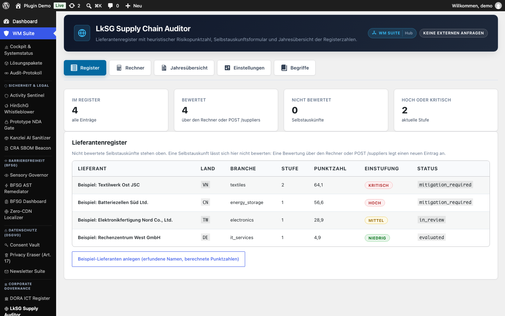
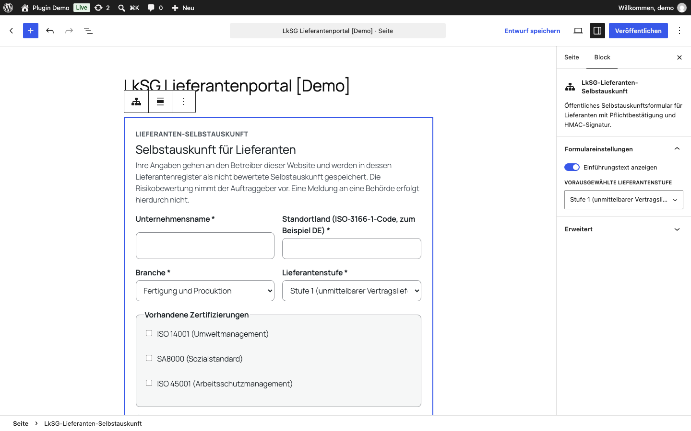
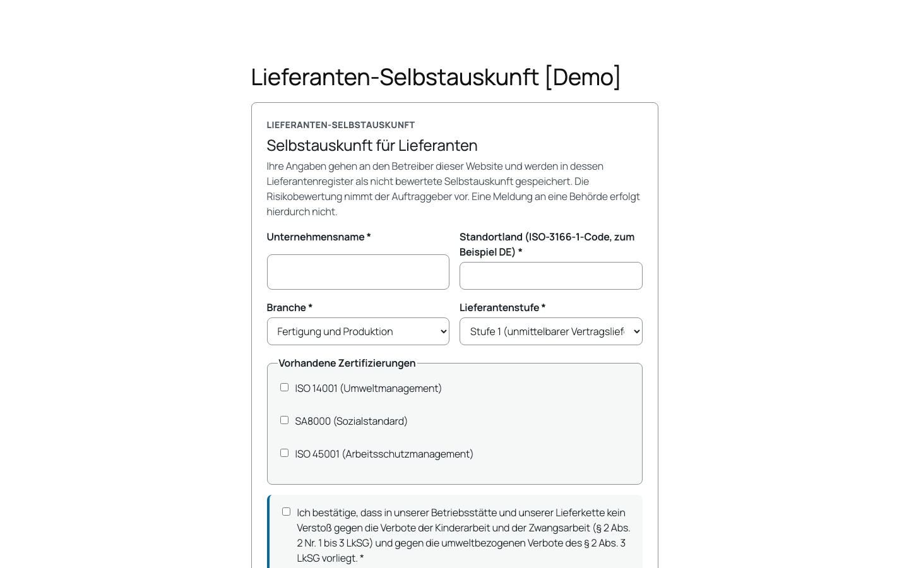

# WM LkSG Supply Chain Auditor

  
  
  

  
  
  

> **Lieferantenregister zum Lieferkettensorgfaltspflichtengesetz (LkSG): eine zweistufige Risikopunktzahl mit festen heuristischen Gewichten, ein öffentliches Selbstauskunftsformular, dessen Erklärungen gespeichert und signiert werden, und eine Jahreszählung dessen, was im Register steht – über eine deutsche Admin-Oberfläche, einen Gutenberg-Block, REST-Routen und WP-CLI. Das Plugin erstellt keinen Bericht nach § 10 Abs. 2 LkSG und sendet nichts an das BAFA.**  
> **Plugin-Seite:** [https://arnoldwender.com/wordpress-plugins/wm-lksg-supply-auditor/](https://arnoldwender.com/wordpress-plugins/wm-lksg-supply-auditor/)  
> **Mit einem agentischen Workflow entwickelt:** entstanden mit KI-Coding-Agenten. Prüfen und testen Sie es wie jeden fremden Code, bevor Sie es produktiv einsetzen.  
> **Support & Haftung:** Kein Support (Zero Support) — reproduzierbare Bugs ausschließlich über [GitHub Issues](https://github.com/arnoldwender/wm-wp-lksg-supply-auditor/issues) · kein privater Support · OHNE GEWÄHR („AS IS“) / keine Haftung ([SUPPORT.md](SUPPORT.md))

> Bis zum 2026-09-15 zeigte die README Abzeichen für "LkSG §§ 1-10 Compliant", "EU CSDDD Ready" und "BAFA Report Automated". Gemessen am Code lieferte der BAFA-Export feste Werte für Grundsatzerklärung, Präventionsmaßnahmen, Schulungen, einen Beauftragten und einen Beschwerdekanal, auch bei leerem Register und für jedes Jahr dieselben Zahlen; ein Lieferant ohne Land wurde als Deutschland bewertet; angegebene Zertifizierungen wurden verworfen.

---

## Live-Vorschau

!WM LkSG Supply Chain Auditor Banner

| Risikoregister | Block-Editor | Selbstauskunft-Portal |
|---|---|---|
|  |  |  |

---

## Was das Plugin tut

1. **Register.** Tabelle `wp_wm_lksg_suppliers`: Unternehmen, Land (ISO 3166-1 Alpha-2), Branche, Stufe 1 bis 3, Punktzahl, Einstufung, Status. Die Übersicht zeigt 50 Einträge je Seite, nicht bewertete Selbstauskünfte zuerst, mit Zählern für alle, bewertete, nicht bewertete und hoch oder kritisch eingestufte Lieferanten.
2. **Punktzahl.** Abstrakte Stufe `0,40 × Land + 0,40 × Sektor + 0,20 × Produkt`; konkrete Stufe `0,40 × Schwere + 0,40 × Wahrscheinlichkeit + 0,10 × Abhängigkeit + 0,10 × Verursachungsbeitrag − 10 (ISO 14001) − 15 (SA 8000)`, begrenzt auf 0 bis 100; Gesamt `0,30 × abstrakt + 0,70 × konkret` (Filter `wm_lksg_risk_score`). Kritisch ab 75 oder ab einer Schwere von 85, hoch ab 50, mittel ab 25, sonst niedrig. Länderstufen: DE 15, TW 30, CN 60, VN 60, IN 70, BD 85, jedes andere Land 50 (`wm_lksg_country_cpi_risk`). Gewichte, Stufen, Sektorprofile und Grenzen sind Heuristiken von WM Suite; das Gesetz nennt Kriterien (§ 3 Abs. 2 LkSG), keine Gewichte.
3. **Bewertungsverlauf.** Jede gespeicherte Bewertung schreibt Punktzahl, Einstufung, Auslöser und alle Faktoren in `wp_wm_lksg_risk_assessments`. Lässt sich diese Zeile nicht schreiben, wird der Lieferant wieder entfernt.
4. **Selbstauskunft und Gutenberg-Block.** Der Block `wm/lksg-supplier-portal` (sichtbar im Block-Inserter mit `InspectorControls` und `ServerSideRender`) und der Shortcode `[wm_lksg_supplier_portal]` fragen Unternehmen, Land, Branche, Stufe, drei Zertifizierungen und eine Pflichterklärung ab. Gespeichert werden der Lieferant als nicht bewertet und eine Zeile mit den angegebenen Zertifizierungen, dem bestätigten Wortlaut, der Zeit und einer HMAC-SHA256-Signatur (`RestController::verify_signature()`). Ratenbegrenzung ohne Speicherung roher IP-Adressen (`wm_lksg_rl_*`, Standard 30 Anfragen/Minute über `wm_lksg_rest_rate_limit`, sowie fünf angenommene Selbstauskünfte je Stunde).
5. **Jahresübersicht.** `GET /wp-json/wm-lksg/v1/bafa-report?year=`, `wp lksg export-bafa --year=` und der Reiter *Jahresübersicht* zählen für ein Kalenderjahr die Lieferanten am Jahresende und die im Jahr erfassten Bewertungen und Selbstauskünfte und nennen, was ein Bericht nach § 10 Abs. 2 LkSG enthält und das Plugin nicht erfasst.
6. **Einstellungen und Deinstallation.** Das Jahr der Übersicht (ohne Eintrag das Vorjahr) sowie die ausdrückliche Opt-in-Option `wm_lksg_delete_data_on_uninstall` (Standard: deaktiviert, sodass Tabellen und Einstellungen gemäß der siebenjährigen Aufbewahrungspflicht nach § 10 Abs. 1 LkSG beim Löschen des Plugins erhalten bleiben).
7. **Admin-Oberfläche.** Menü *LkSG-Lieferanten* mit den Reitern Register, Rechner, Jahresübersicht, Einstellungen und Begriffe; ein Dashboard-Widget; ein Knopf für vier erfundene Beispiel-Lieferanten mit berechneten Punktzahlen.
8. **WP-CLI, Ökosystem & Übersetzungen.** `wp lksg score` und `wp lksg export-bafa`; WordPress 6.5+ Block Bindings (`wm-lksg/metrics`), GenerateBlocks 2.x Dynamic Tag (`{{wm_lksg_metric}}`), Action `wm_lksg_ready`, Hub-Adapter, CycloneDX-1.6-SBOM (`bom.json`) sowie 28 übersetzte Sprachkataloge (`.po`/`.mo` und JED-`.json`).

### Nicht enthalten

Keine Bewertung einer vorhandenen Selbstauskunft (eine Bewertung legt einen neuen Eintrag an); kein Bericht nach § 10 Abs. 2 LkSG und keine Übermittlung an das BAFA; kein Beschwerdeverfahren (§ 8) und keine Anbindung an `wm-hinschg-whistleblower`; keine Verwaltung von Abhilfemaßnahmen (§ 7); keine Grundsatzerklärung, Zuständigkeit, Präventionsmaßnahmen oder Schulungen; keine CSDDD-spezifischen Daten; kein Länderindex; keine Prüfung angegebener Zertifizierungen; keine Identifizierung der absendenden Person; keine automatische Löschfrist.

---

## Schnellstart

1. Plugin aktivieren (WordPress 6.4+, PHP 8.2+); die Aktivierung legt fünf Tabellen an.
2. **LkSG-Lieferanten › Rechner** öffnen oder im Register die Beispiel-Lieferanten anlegen.
3. Block **LkSG-Lieferanten-Selbstauskunft** (`wm/lksg-supplier-portal`) oder `[wm_lksg_supplier_portal]` auf eine Seite setzen.
4. `wp lksg score "Acme Ltd" --country=CN --sector=electronics --severity=60`

Entwickler: [DEVELOPERS.md](DEVELOPERS.md) (englisch).

---

## Bekannte Einschränkungen

- **Die Punktzahl ist eine Heuristik** und kann ganz auf Standardwerten beruhen; eine niedrige Punktzahl belegt nicht, dass keine Risiken bestehen.
- **Die Erklärung umfasst § 2 Abs. 2 Nr. 1 bis 3 und § 2 Abs. 3 LkSG**, nicht die übrigen Verbote des § 2 Abs. 2; Wortlaut und Umfang warten auf eine Entscheidung.
- **Signaturschlüssel:** `wp_salt( 'secure_auth' )` nutzt die Konstanten aus `wp-config.php`, sonst einen in der Datenbank gespeicherten Schlüssel. Selbstauskünfte vor dem 2026-09-15 lassen sich nicht prüfen.
- **Ratenbegrenzung** über einen HMAC-Hash von `REMOTE_ADDR`: hinter einem Reverse Proxy teilen sich alle Besucher einen Zähler.

---

## Rechtlicher Rahmen

Das Plugin sendet nichts nach außen und speichert keine Personennamen oder rohen IP-Adressen. Ob ein Unternehmen unter das Gesetz fällt und ob seine Sorgfalt angemessen ist, entscheidet das Plugin nicht. Zitate und Stand der Berichtspflicht: [docs/LEGAL-COMPLIANCE.md](docs/LEGAL-COMPLIANCE.md).

## Lizenz

GNU General Public License v2 or later (`GPL-2.0-or-later`). Siehe [LICENSE](LICENSE).
