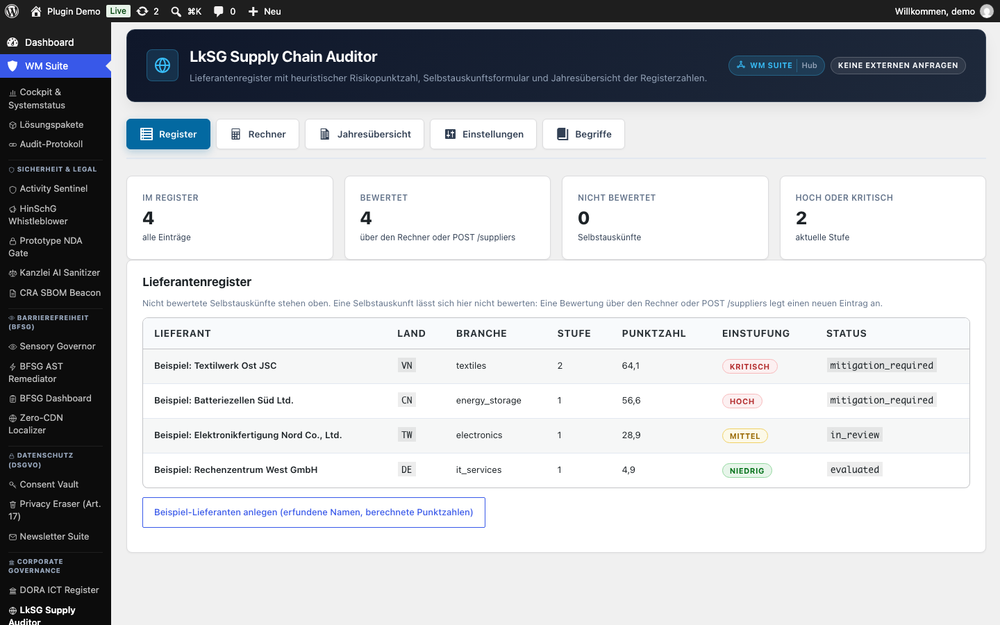
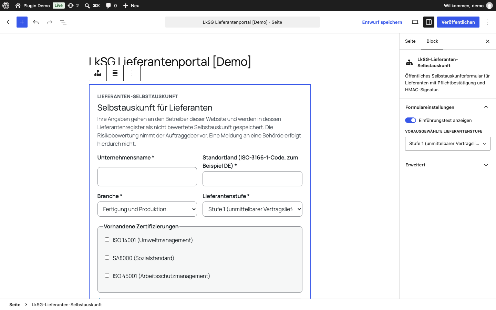
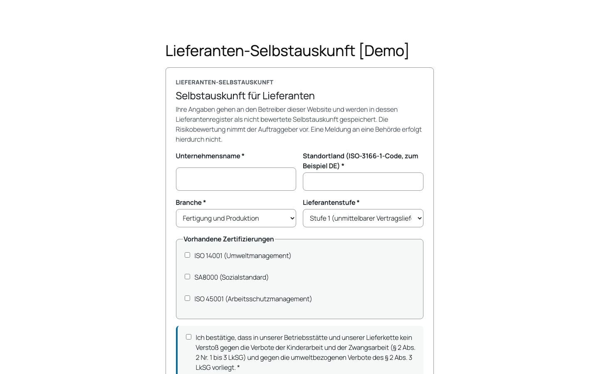

# WM LkSG Supply Chain Auditor

  
  
  

  
  
  

> **Registro de proveedores para la ley alemana de diligencia debida en la cadena de suministro (Lieferkettensorgfaltspflichtengesetz, LkSG): una puntuación de riesgo en dos niveles con pesos heurísticos fijos, un formulario público de autodeclaración cuyas declaraciones se guardan y se firman, y un conteo anual de lo que contiene el registro, con pantalla de administración en alemán, bloque Gutenberg, rutas REST y WP-CLI. El plugin no redacta el informe del § 10 Abs. 2 LkSG ni envía nada al BAFA.**  
> **Página del Plugin:** [https://arnoldwender.com/es/plugins-wordpress/wm-lksg-supply-auditor/](https://arnoldwender.com/es/plugins-wordpress/wm-lksg-supply-auditor/)  
> **Desarrollado con un agentic workflow:** creado con agentes de programación de IA. Revísalo y pruébalo como cualquier código de terceros antes de usarlo en producción.  
> **Soporte y responsabilidad:** Cero soporte (Zero Support) — errores reproducibles únicamente en [GitHub Issues](https://github.com/arnoldwender/wm-wp-lksg-supply-auditor/issues) · sin soporte privado · TAL CUAL («AS IS») / sin responsabilidad ([SUPPORT.md](SUPPORT.md))

> Hasta el 2026-09-15 este README mostraba insignias de "LkSG §§ 1-10 Compliant", "EU CSDDD Ready" y "BAFA Report Automated". Medido contra el código, la exportación BAFA devolvía valores fijos para la declaración de principios, las medidas preventivas, las formaciones, un responsable y un canal de denuncias, también con el registro vacío y con las mismas cifras para cualquier año; un proveedor sin país se puntuaba como Alemania; las certificaciones declaradas se descartaban.

---

## Capturas en vivo

!Banner de WM LkSG Supply Chain Auditor

| Registro de riesgos | Editor de bloques | Portal de autodeclaración |
|---|---|---|
|  |  |  |

---

## Qué hace el plugin

1. **Registro.** Tabla `wp_wm_lksg_suppliers`: empresa, país (ISO 3166-1 alfa-2), sector, nivel 1 a 3, puntuación, nivel de riesgo y estado. La vista general muestra 50 proveedores por página, primero las autodeclaraciones sin evaluar, con conteos de todos, evaluados, sin evaluar y de riesgo alto o crítico.
2. **Puntuación.** Nivel abstracto `0,40 × país + 0,40 × sector + 0,20 × producto`; nivel concreto `0,40 × gravedad + 0,40 × probabilidad + 0,10 × dependencia + 0,10 × contribución causal − 10 (ISO 14001) − 15 (SA 8000)`, limitado a 0-100; total `0,30 × abstracto + 0,70 × concreto` (filtro `wm_lksg_risk_score`). Crítico desde 75 o con gravedad desde 85, alto desde 50, medio desde 25, bajo en otro caso. Valores por país: DE 15, TW 30, CN 60, VN 60, IN 70, BD 85; cualquier otro país, 50 (`wm_lksg_country_cpi_risk`). Pesos, valores por país, perfiles de sector y umbrales son heurísticas de WM Suite; la ley nombra criterios (§ 3 Abs. 2 LkSG), no pesos.
3. **Historial de evaluaciones.** Cada evaluación guardada escribe puntuación, nivel, disparador y todos los factores en `wp_wm_lksg_risk_assessments`. Si esa fila no se puede escribir, el proveedor se elimina de nuevo.
4. **Autodeclaración y bloque Gutenberg.** El bloque `wm/lksg-supplier-portal` (visible en el insertador de bloques con `InspectorControls` y `ServerSideRender`) y el shortcode `[wm_lksg_supplier_portal]` piden empresa, país, sector, nivel, tres certificaciones y una declaración obligatoria. Se guardan el proveedor sin evaluar y una fila con las certificaciones declaradas, el texto confirmado, la hora y una firma HMAC-SHA256 verificable con `RestController::verify_signature()`. Límite de peticiones por hash HMAC de IP (`wm_lksg_rl_*`, 30 req/min por defecto mediante `wm_lksg_rest_rate_limit`, más cinco envíos aceptados por hora).
5. **Resumen anual.** `GET /wp-json/wm-lksg/v1/bafa-report?year=`, `wp lksg export-bafa --year=` y la pestaña *Jahresübersicht* cuentan, para un año natural, los proveedores al cierre del año y las evaluaciones y autodeclaraciones registradas en él, y enumeran lo que un informe del § 10 Abs. 2 LkSG debe cubrir y el plugin no registra.
6. **Ajustes y desinstalación opt-in.** El año del resumen (sin valor, el año anterior) y la opción explícita `wm_lksg_delete_data_on_uninstall` (desactivada por defecto para conservar tablas y ajustes ante el deber de conservación de siete años del § 10 Abs. 1 LkSG).
7. **Administración, WP-CLI y ecosistema.** Menú *LkSG-Lieferanten*, widget en el escritorio, botón de proveedores de ejemplo; `wp lksg score` y `wp lksg export-bafa`; WordPress 6.5+ Block Bindings (`wm-lksg/metrics`), GenerateBlocks 2.x Dynamic Tag (`{{wm_lksg_metric}}`), acción `wm_lksg_ready`, adaptador del hub, SBOM CycloneDX 1.6 (`bom.json`) y 28 catálogos de idioma traducidos (`.po`/`.mo` y JED `.json`).

### No incluido

Evaluar una autodeclaración existente (una evaluación crea una fila nueva); el informe del § 10 Abs. 2 LkSG o cualquier envío al BAFA; procedimiento de denuncias (§ 8) y conexión con `wm-hinschg-whistleblower`; gestión de medidas correctivas (§ 7); declaración de principios, responsable, medidas preventivas o formaciones; datos específicos de la CSDDD; índice de países; comprobación de las certificaciones declaradas; identificación de quien envía; purga automática de conservación.

---

## Inicio rápido

1. Activa el plugin (WordPress 6.4+, PHP 8.2+); la activación crea cinco tablas.
2. Abre **LkSG-Lieferanten › Rechner** o crea los proveedores de ejemplo desde el registro.
3. Inserta el bloque `wm/lksg-supplier-portal` o `[wm_lksg_supplier_portal]` en una página.
4. `wp lksg score "Acme Ltd" --country=CN --sector=electronics --severity=60`

Desarrollo: [DEVELOPERS.md](DEVELOPERS.md) (en inglés).

---

## Limitaciones conocidas

- **La puntuación es una heurística** y puede basarse por completo en valores por defecto; una puntuación baja no demuestra que no haya riesgos.
- **La declaración cubre el § 2 Abs. 2 Nr. 1 a 3 y el § 2 Abs. 3 LkSG**, no las demás prohibiciones del § 2 Abs. 2; su redacción y alcance esperan una decisión.
- **Clave de firma:** `wp_salt( 'secure_auth' )` usa las constantes de `wp-config.php` y, si faltan, una clave guardada en la base de datos. Las autodeclaraciones anteriores al 2026-09-15 no se pueden verificar.
- **Límite de envíos** por hash HMAC de `REMOTE_ADDR`: detrás de un proxy inverso todos los visitantes comparten un contador.

---

## Marco legal

El plugin no envía nada fuera ni guarda nombres de personas o direcciones IP en bruto. Si una empresa está sujeta a la ley y si su diligencia es adecuada no lo decide el plugin. Citas y estado del deber de informe: [docs/LEGAL-COMPLIANCE.md](docs/LEGAL-COMPLIANCE.md).

## Licencia

GNU General Public License v2 or later (`GPL-2.0-or-later`). Véase [LICENSE](LICENSE).
