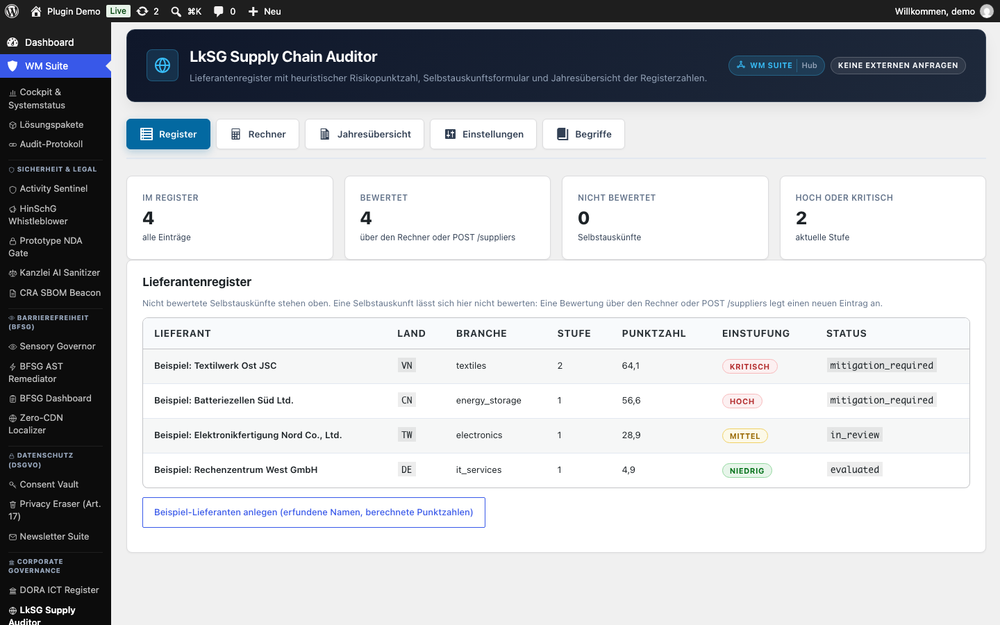
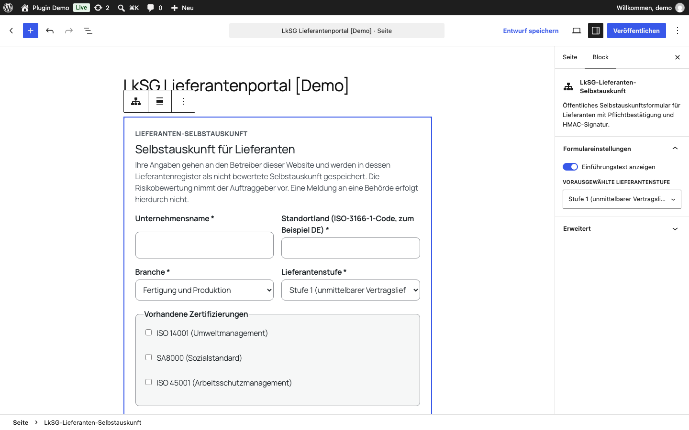
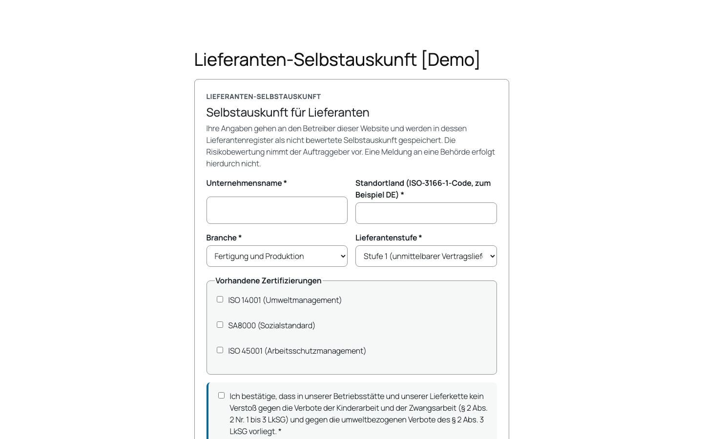

# WM LkSG Supply Chain Auditor

<p align="center">
  <a href="README.md"></a>
  <a href="README.de.md"></a>
  <a href="README.es.md"></a>
</p>

<p align="center">
  <a href="https://wordpress.org"></a>
  <a href="https://php.net"></a>
  
  <a href="https://www.gnu.org/licenses/gpl-2.0.html"></a>
</p>

> **A supplier register for the German supply-chain due-diligence act (Lieferkettensorgfaltspflichtengesetz, LkSG): a two-level risk score with fixed heuristic weights, a public self-disclosure form whose declarations are stored and signed, and a yearly count of what the register holds — through a German admin screen, Gutenberg block, REST routes and WP-CLI. It does not write the report under § 10 Abs. 2 LkSG and sends nothing to the BAFA.**  
> **Plugin page:** [https://arnoldwender.com/wordpress-plugins/wm-lksg-supply-auditor/](https://arnoldwender.com/wordpress-plugins/wm-lksg-supply-auditor/)  
> **Built with an agentic workflow:** developed with AI coding agents. Review and test it like any third-party code before you use it in production.  
> **Support & Liability:** Zero support — reproducible bugs on [GitHub Issues](https://github.com/arnoldwender/wm-wp-lksg-supply-auditor/issues) only · no private support · AS IS / no liability ([SUPPORT.md](SUPPORT.md))

> Until 2026-09-15 this README showed badges for "LkSG §§ 1-10 Compliant", "EU CSDDD Ready" and "BAFA Report Automated" and described a "Multi-Tier Supplier ESG Risk Scoring Engine", an "Automated BAFA Annual Report Generator", an "Interlinked Whistleblower Complaint Mechanism" and "Audit-Proof Documentation" with certification tracking. Measured against the code: the BAFA export returned a policy statement, prevention measures, trainings, an officer and a complaints gateway as fixed values on an empty register and gave the same numbers for every year; nothing wrote the complaints or corrective-action tables; the tier never entered the score; declared certifications were thrown away; a supplier without a country was scored as Germany; the admin screen said "PREPARADO" and "VINCULADO" whatever the register held. This file describes what the plugin does now.

---

## Showcase

!WM LkSG Supply Chain Auditor banner

The banner above and the live WordPress screenshots below live in `.wordpress-org/`; the old marketing mockups were archived outside the repository on 2026-11-20 (release 1.2.0).

| Risk Register | Block Editor | Supplier Portal |
|---|---|---|
|  |  |  |

---

## What the plugin does

1. **Register.** Table `wp_wm_lksg_suppliers`: company, ISO 3166-1 alpha-2 country, sector key, tier 1 to 3, score, level, status. The admin overview lists 50 suppliers per page, unassessed self-disclosures first, with counts of all, assessed, unassessed and high or critical suppliers.
2. **Score.** `RiskMatrixCalculator` computes an abstract level `0.40 × country + 0.40 × sector + 0.20 × product` and a concrete level `0.40 × severity + 0.40 × probability + 0.10 × dependency + 0.10 × causal contribution − 10 (ISO 14001) − 15 (SA 8000)`, clamped to 0-100, and the score `0.30 × abstract + 0.70 × concrete` (filterable via `wm_lksg_risk_score`). Level `critical` from 75 or from a severity of 85, `high` from 50, `medium` from 25, otherwise `low`, with the triggers `CAPA_REQUIRED`, `AUDIT_REQUIRED`, `QUESTIONNAIRE_REQUIRED` and `NO_ACTION`. Country tiers: DE 15, TW 30, CN 60, VN 60, IN 70, BD 85; any other country 50 (filter `wm_lksg_country_cpi_risk`). Sector profiles run from software (15/10) to mining (85/85). Weights, tiers, profiles and thresholds are WM Suite heuristics; the act names criteria (§ 3 Abs. 2 LkSG), not weights.
3. **Assessment history.** Every evaluation that stores a supplier also writes a row to `wp_wm_lksg_risk_assessments` with the score, the level, the trigger and every factor as JSON. If that row cannot be written, the supplier row is removed again and the caller gets an error.
4. **Self-disclosure form and Gutenberg block.** The block `wm/lksg-supplier-portal` (visible in the Block Inserter with `InspectorControls` and `ServerSideRender`) and the shortcodes `[wm_lksg_supplier_portal]` and `[wm_lksg_declaration]` ask for company, country code, sector, tier, three certifications and a declaration the supplier has to tick. `POST /wp-json/wm-lksg/v1/self-disclosure` guards access with per-minute HMAC-SHA256 IP rate-limiting (`wm_lksg_rl_*`, default 30 requests/minute, filter `wm_lksg_rest_rate_limit`, bypassed for `manage_options`), stores the supplier as `unassessed` / `self_disclosed` and writes an audit row with the declared certifications, the declared text, the time and an HMAC-SHA256 signature over them; `RestController::verify_signature()` checks a stored row. Up to five accepted submissions per client address per hour (`wm_lksg_sd_*`), answering with a uuid reference.
5. **Yearly summary.** `GET /wp-json/wm-lksg/v1/bafa-report?year=`, `wp lksg export-bafa --year=` and the admin tab *Jahresübersicht* count, for one calendar year (UTC), the suppliers in the register at the end of the year (of them tier 1, tier 2 or higher, unassessed, high or critical by their current level) and the assessments and self-disclosures recorded during the year. The summary names what a report under § 10 Abs. 2 LkSG covers and the plugin does not record. Route and command keep their old names.
6. **Settings and opt-in uninstall.** The settings tab configures the calendar year the summary counts (default: the previous calendar year) and an explicit opt-in checkbox (`wm_lksg_delete_data_on_uninstall`, default off). By default, uninstalling the plugin preserves all supplier, assessment and self-disclosure tables and options in view of the seven-year retention duty under § 10 Abs. 1 LkSG.
7. **Admin screen.** Menu *LkSG-Lieferanten* (`manage_options`), German tabs *Register*, *Rechner*, *Jahresübersicht*, *Einstellungen*, *Begriffe*; a dashboard widget with the counts; a button that adds four made-up demo suppliers whose names start with `Beispiel:` and whose scores are computed.
8. **WP-CLI.** `wp lksg score "<name>" [--country=] [--sector=] [factors]` prints both levels and the result and stores nothing; `wp lksg export-bafa [--year=]` prints the summary.
9. **Ecosystem bridges & i18n.** WordPress 6.5+ Block Bindings source `wm-lksg/metrics`, GenerateBlocks 2.x Dynamic Tag `{{wm_lksg_metric}}`, action `wm_lksg_ready`, WM Suite Hub spoke adapter (`Lksg_Spoke_Adapter`), CycloneDX 1.6 `bom.json`, and 28 UI locales (`.po`/`.mo` and JED `.json`).

### Not shipped

No assessment of an existing self-disclosure (an evaluation in the calculator or through `POST /suppliers` creates a new row); no report under § 10 Abs. 2 LkSG and no submission to the BAFA; no complaints procedure (§ 8) and no connection to `wm-hinschg-whistleblower` (the complaints table is created and nothing writes it); no corrective-action management (§ 7; the table is created and unused); no policy statement, responsible person, prevention measures or trainings; no data specific to the EU CSDDD; no country index (the tiers are six heuristic values); no data source for child labour or environmental harm; no check of declared certifications; no identification of the person who submits a self-disclosure; no editing or deleting of suppliers in the admin screen; no automatic retention purge.

---

## Quick start

1. Install and activate the plugin (WordPress 6.4+, PHP 8.2+). Activation creates five tables.
2. Open **LkSG-Lieferanten › Rechner** and score a supplier, or add the demo suppliers from the *Register* tab.
3. Insert the **LkSG-Lieferanten-Selbstauskunft** (`wm/lksg-supplier-portal`) block or `[wm_lksg_supplier_portal]` shortcode on a page to collect self-disclosures.
4. On the server: `wp lksg score "Acme Ltd" --country=CN --sector=electronics --severity=60`
5. `wp lksg export-bafa --year=2025`

---

## Developers

Classes, routes, hooks, block bindings, the signature, the summary and the tests: **[DEVELOPERS.md](DEVELOPERS.md)**. Architecture: **[docs/ARCHITECTURE.md](docs/ARCHITECTURE.md)**. Legal context: **[docs/LEGAL-COMPLIANCE.md](docs/LEGAL-COMPLIANCE.md)**.

```bash
php tests/test-suite.php        # standalone, no WordPress; $wpdb on in-memory SQLite (pdo_sqlite)
php tests/test-pot-freshness.php # POT catalog freshness check via WP-CLI
bash tests/run-mutations.sh     # undoes each correction once (tests/mutations.php); the suite must fail every time
vendor/bin/phpunit              # tests/Unit, after composer install
wp eval-file wp-content/plugins/wm-lksg-supply-auditor/tests/wp-runtime-lksg.php --user=1   # inside WordPress, rolled back
```

### Known issues

- **The score is a heuristic.** It rests on six country values, sector profiles and weights chosen by WM Suite and can rest entirely on defaults. A low score does not show that there are no risks.
- **Self-disclosures cannot be assessed in place.** Scoring the same supplier creates a second row next to the unassessed one.
- **The declaration covers § 2 Abs. 2 Nr. 1 to 3 and § 2 Abs. 3 LkSG**, not the other prohibitions of § 2 Abs. 2; its wording and scope wait for a decision.
- **Signature key.** `wp_salt( 'secure_auth' )` uses the `SECURE_AUTH_*` constants of `wp-config.php` when they are set; otherwise WordPress stores a generated key in the database, and whoever can write the database can re-sign a row. Rows written before 2026-09-15 carry no declared facts and cannot be verified; their four score columns keep 0.
- **Rate limit.** Keyed on an HMAC-SHA256 hash of `REMOTE_ADDR`: behind a reverse proxy every visitor shares one bucket, and parallel requests can pass the limit.
- **Translated declaration.** The stored text is the one the server signed in the language of the request; with a multilingual plugin that language can differ from the page the supplier saw.

---

## Legal context

- **No outbound requests:** the plugin sends nothing to the BAFA or anyone else.
- **Stored data:** company names, countries, sectors, tiers, scores and their factors; for self-disclosures the declared certifications, the declaration text and the time. No names of people and no raw IP addresses; the rate limits keep keyed HMAC-SHA256 hashes of the client address as transient keys.
- **Scope:** whether a company falls under the act (§ 1 LkSG) and whether its due diligence is adequate is not decided by the plugin. The status of the reporting duty and the quoted provisions: [docs/LEGAL-COMPLIANCE.md](docs/LEGAL-COMPLIANCE.md).

---

## Contribution & Security

- [CONTRIBUTING.md](CONTRIBUTING.md) · [SECURITY.md](SECURITY.md) · [CHANGELOG.md](CHANGELOG.md)

---

## License

GNU General Public License v2 or later (`GPL-2.0-or-later`). See [LICENSE](LICENSE) for full terms.  
